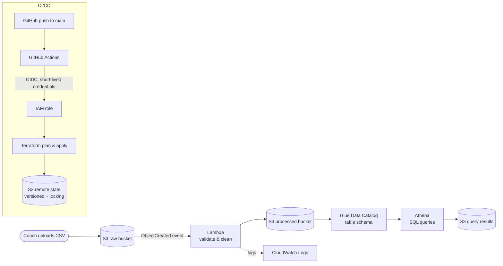

# Athlete Performance Data Pipeline

An event-driven, serverless data pipeline on AWS that turns raw athlete test results into queryable insight for coaches, such as *"how much has each athlete improved their 10m sprint this block?"*

All infrastructure is defined in **Terraform** and deployed by **GitHub Actions** using **OIDC**, with no AWS access keys stored anywhere.

## Architecture



## How it works

1. A coach uploads a CSV of test results (`athlete_id, test_date, test_name, value`) to the raw bucket.
2. The S3 upload event triggers a Python Lambda, which validates every row: allowed tests only, real dates, positive numbers.
3. Clean rows are written to the processed bucket, and invalid rows are counted and logged.
4. A Glue table describes the processed data, so Athena can query it with standard SQL.

Example query (per-athlete 10m sprint improvement):

```sql
SELECT athlete_id,
       MIN_BY(value, test_date) AS first_time,
       MAX_BY(value, test_date) AS latest_time,
       ROUND(MIN_BY(value, test_date) - MAX_BY(value, test_date), 2) AS improvement_secs
FROM results
WHERE test_name = 'sprint_10m'
GROUP BY athlete_id
ORDER BY improvement_secs DESC;
```

## Design decisions

| Decision | Why |
|---|---|
| OIDC instead of access keys | Credentials are temporary and only issued to this repo's `main` branch |
| Least-privilege Lambda role | Read raw, write processed, write logs. Nothing else |
| Remote state in versioned S3 with locking | Every pipeline run shares one source of truth, and bad state can be rolled back |
| Serverless (Lambda + Athena) | No servers to manage; pay per use, so costs are close to zero at this scale |
| Idempotent Lambda | S3 retries failed async invocations twice; re-running produces the same output |

## Lessons from troubleshooting

- **OIDC login refused:** a CloudTrail `AssumeRoleWithWebIdentity` event showed GitHub's token subject now includes account and repository IDs. I updated the IAM trust policy to match.
- **Lambda `HandlerNotFound` / syntax errors:** traced through CloudWatch Logs to an empty file and a broken indent, then fixed and redeployed through the pipeline.

## Repository structure

```
.github/workflows/terraform.yml   # CI/CD: init, validate, plan, apply
terraform/main.tf                 # provider, remote state, raw bucket
terraform/pipeline.tf             # processed bucket, Lambda, IAM, S3 trigger
terraform/athena.tf               # Glue catalog, Athena workgroup
terraform/lambda/process_results.py
```

## Roadmap

- Plan-only checks on pull requests
- Unit tests for the Lambda
- Dead-letter queue for events that fail every retry
- CloudWatch alarms and cost budget alerts
- Replace the build-time admin role with a least-privilege deploy role
